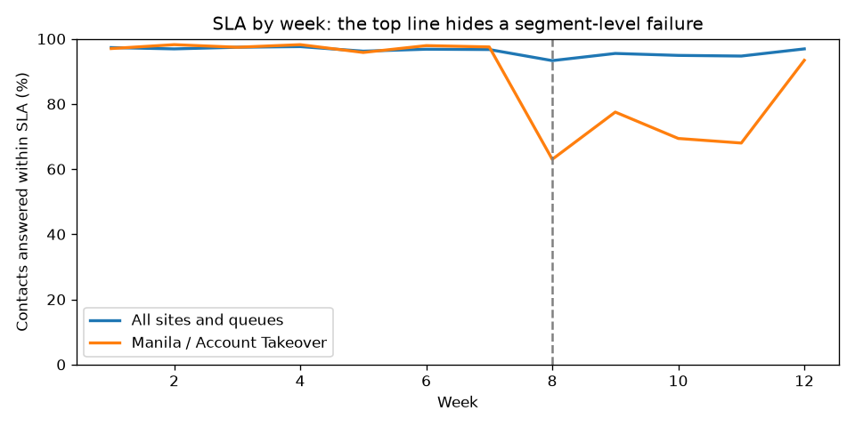

# Operations Root-Cause Analysis

When a frontline metric moves, the hard part is answering *why* quickly: which site, queue, vendor or staffing change caused it, how big the effect is, and what to do next.

This project simulates 12 weeks of contacts (~50,000) for a multi-site, multi-vendor trust and safety operation, with one problem planted in the data. Four SQL queries find it without being told where to look, and a script writes the root-cause report.



## The answer it produces

> SLA on **Account Takeover at Manila (Vendor B)** fell from 97.4% to 74.0% from week 8, the largest contribution (-1.84 pts) to the drop in overall SLA. Demand was flat (+1.5%), but handle time rose 38% as new hires took a large share of contacts (peaking at 74% of contacts). New hires average 867s per contact against 541s for tenured specialists, so workload reached up to 117% of contracted hours and waits breached SLA.

The full report, with a recommendation and a "what the data cannot tell us" section, is in [`output/report.md`](output/report.md).

## How it works

| Step | Query | Question |
|---|---|---|
| 1 | `01_weekly_topline.sql` | What does leadership see? (SLA barely moves, so the top line hides the problem) |
| 2 | `02_sla_change_by_segment.sql` | Which site × queue moved, and how many points of overall SLA does each explain? |
| 3 | `03_segment_drivers.sql` | Inside that segment, is it demand, handle time, staffing mix or occupancy? |
| 4 | `04_aht_by_tenure.sql` | How much slower are new hires? (sizes the effect) |

The change week is detected automatically as the largest sustained step down in SLA. The report text is generated from the query results, so nothing about the answer is hard-coded.

## Metrics used

SLA (share of contacts answered within 60 minutes), AHT (average handle time), occupancy (handled time ÷ contracted hours), tenure bands, contribution analysis (each segment's share of the overall change).

## Run it

```bash
pip install -r requirements.txt
python -m rca.generate     # writes data/contacts.csv and data/specialists.csv
python -m rca.analyze      # writes output/report.md and output/sla_by_week.png
pytest
```

The tests check that the analysis finds the planted cause at the right week, that contributions cover every segment, and that change-week detection works.

## Stack

SQL (DuckDB, parameterised queries), Python, matplotlib, pytest.
