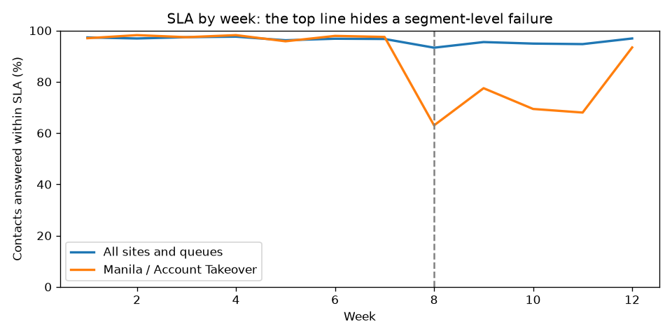

# Root-cause analysis: SLA drop from week 8

## One clear answer

SLA on **Account Takeover at Manila (Vendor B)** fell from 97.4% to 74.0% from week 8, the largest contribution (-1.84 pts) to the drop in overall SLA. Demand was flat (+1.5%), but handle time rose 38% as new hires took a large share of contacts (peaking at 74.0% of contacts). New hires average 867s per contact against 541s for tenured specialists, so workload reached up to 117.2% of contracted hours and waits breached SLA.

**Recommendation:** for the next 4 weeks, add temporary capacity to Manila / Account Takeover (about the gap between
new-hire and tenured handle time across the new hires' share of volume), or route overflow to the
best-performing site on the same queue. Pair new hires with tenured specialists until their AHT is within 15%
of tenured AHT. Set a guardrail: the vendor must flag any staffing swap above 25% of a queue in advance.

**What the data cannot tell us:** whether the vendor changed its training programme, or whether new hires are
also less accurate. That needs Quality Analytics case audits for the same period.

## 1. Top line

| week | contacts | sla_pct | aht_seconds |
|---|---|---|---|
| 1 | 4512 | 97.3 | 520.0 |
| 2 | 4611 | 96.9 | 520.0 |
| 3 | 4457 | 97.4 | 520.0 |
| 4 | 4523 | 97.6 | 520.0 |
| 5 | 4680 | 96.2 | 523.0 |
| 6 | 4517 | 96.8 | 521.0 |
| 7 | 4614 | 96.7 | 518.0 |
| 8 | 4573 | 93.3 | 541.0 |
| 9 | 4531 | 95.5 | 539.0 |
| 10 | 4449 | 94.9 | 542.0 |
| 11 | 4614 | 94.7 | 539.0 |
| 12 | 4511 | 96.9 | 528.0 |

## 2. Which segment moved? (baseline weeks 1 to 7 vs recent weeks 8+)

| site | vendor | queue | sla_baseline_pct | sla_recent_pct | sla_change_pts | contribution_to_overall_pts |
|---|---|---|---|---|---|---|
| Manila | Vendor B | Account Takeover | 97.4 | 74.0 | -23.4 | -1.84 |
| Bogota | Vendor A | Listing Safety | 98.5 | 98.1 | -0.5 | -0.16 |
| Bogota | Vendor A | Account Takeover | 97.4 | 96.7 | -0.7 | -0.13 |
| Manila | Vendor B | Listing Safety | 98.2 | 97.9 | -0.4 | -0.11 |
| Dublin | In-house | Account Takeover | 96.9 | 98.1 | 1.2 | -0.1 |
| Dublin | In-house | Listing Safety | 98.5 | 98.2 | -0.3 | -0.05 |
| Dublin | In-house | Payment Fraud | 95.3 | 96.3 | 1.1 | 0.03 |
| Bogota | Vendor A | Payment Fraud | 94.9 | 96.0 | 1.1 | 0.03 |
| Lisbon | In-house | Payment Fraud | 95.2 | 94.7 | -0.5 | 0.06 |
| Lisbon | In-house | Listing Safety | 97.8 | 98.2 | 0.4 | 0.08 |
| Lisbon | In-house | Account Takeover | 97.8 | 97.6 | -0.2 | 0.11 |
| Manila | Vendor B | Payment Fraud | 95.6 | 95.6 | 0.0 | 0.17 |

## 3. Drivers inside Manila / Account Takeover

| week | contacts_per_day | aht_seconds | pct_contacts_new_hires | active_specialists | occupancy_pct | avg_wait_minutes | sla_pct |
|---|---|---|---|---|---|---|---|
| 1 | 52.285714285714285 | 546.0 | 0.0 | 8 | 75.2 | 15.0 | 97.0 |
| 2 | 54.42857142857143 | 542.0 | 0.0 | 8 | 77.6 | 16.0 | 98.2 |
| 3 | 54.857142857142854 | 540.0 | 0.0 | 8 | 78.0 | 15.4 | 97.4 |
| 4 | 54.285714285714285 | 539.0 | 0.0 | 8 | 77.0 | 15.4 | 98.2 |
| 5 | 57.857142857142854 | 541.0 | 0.0 | 8 | 82.4 | 18.4 | 95.8 |
| 6 | 55.714285714285715 | 540.0 | 0.0 | 8 | 79.2 | 15.1 | 97.9 |
| 7 | 52.285714285714285 | 537.0 | 0.0 | 8 | 73.9 | 16.5 | 97.5 |
| 8 | 57.57142857142857 | 774.0 | 70.7 | 14 | 117.2 | 71.6 | 63.0 |
| 9 | 52.714285714285715 | 781.0 | 74.0 | 14 | 108.4 | 45.1 | 77.5 |
| 10 | 55.57142857142857 | 774.0 | 72.0 | 14 | 113.2 | 54.7 | 69.4 |
| 11 | 57.142857142857146 | 762.0 | 67.8 | 14 | 114.6 | 53.4 | 68.0 |
| 12 | 53.714285714285715 | 640.0 | 0.0 | 14 | 90.5 | 20.7 | 93.4 |

## 4. Handle time by tenure (recent period)

| tenure_band | contacts | aht_seconds |
|---|---|---|
| 0-4 weeks | 1109 | 867.0 |
| 4-8 weeks | 266 | 682.0 |
| 8+ weeks | 562 | 541.0 |
